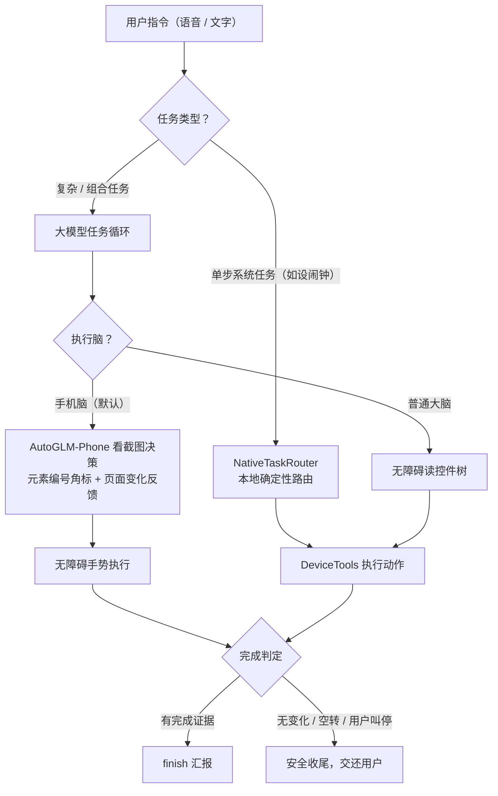

# AI小助手

<p align="left">
  
  
  
</p>

对它说一句话，它调用大模型**自动帮你操作手机**：打开 App、点按钮、打字发消息、设闹钟、记便签、查通知、联网搜索……同时用「完成判定 + 安全红线 + 一键叫停」保证它做得完、停得住、不越界。

## 目录

- [功能特性](#功能特性)
- [快速开始](#快速开始)
- [工作原理](#工作原理)
- [项目结构](#项目结构)
- [构建与测试](#构建与测试)
- [开发规范](#开发规范)
- [隐私与安全](#隐私与安全)
- [已知限制](#已知限制)
- [更新日志](#更新日志)

## 功能特性

### 双脑执行架构

根据页面类型选择合适的执行方式，设置页可随时切换：

| | 手机脑（视觉，**默认**） | 普通大脑（控件树） |
|---|---|---|
| 原理 | AutoGLM-Phone 模型看**截图**决策，输出坐标动作，由无障碍手势执行 | 无障碍读控件树，大模型直接选控件操作 |
| 适合 | 抖音、小红书、游戏等自绘界面、图标无文字的页面 | 设置、闹钟、微信等文字界面 |
| 代价 | 消耗视觉模型额度（智谱模型限时免费，需智谱 Key） | 纯文字、省流量 |
| 增强 | 截图元素编号角标（Set-of-Marks）、动作后页面变化反馈、读屏到的真实控件优先于视觉坐标 | —— |

厂商不是智谱时会自动降级为普通大脑并提示，不会报错中断。

### 自动执行能力

基于 function calling + 无障碍服务，覆盖日常手机操作：

- **App 与屏幕**：打开/列出任意 App、读屏、点击、输入文字、滑动、返回、回桌面
- **通讯**：打电话、发短信、查找联系人、读通知（知道微信/QQ/短信里谁发了什么 → 帮你回复）
- **效率**：设/取消闹钟、创建日历事件、记/查/删便签、复制到剪贴板
- **信息**：打开并读取网页、联网搜索、获取当前时间

### 任务完成判定

AI 不是"走完流程就算完"：打开应用可机械确认完成；判定完成必须引用页面上的**完成证据**（余额/金币确实增加、任务项变为已完成、明确的领取成功提示），引用不出来就继续干；长时间挂机会到点询问是否继续；页面长时间无变化会自动停止并交还用户，不空转、不假装完成。

### 本地任务路由与守卫

- **NativeTaskRouter**：设闹钟这类单步系统任务在本地确定性路由，不交给模型猜工具
- **ContextCompressor**：按字符预算压缩对话历史，长会话不爆上下文
- **TaskAppGuard / PageGuard / ExitMemory**：任务期锁定目标应用、页面守卫、记住退出路线
- **TaskGoalVerifier**：时间/数量/日期类目标保存前与屏幕证据闭环校验

### 任务录制与图形样本库

- **任务录制**：侧边栏发起，悬浮条录制操作过程，可随时取消
- **图形样本库**：为纯图形按钮保存样本，点选时按触点识别可见控件并用截图裁出候选区域，确认窗带缩略图预览

### 多厂商大模型自由切换

ccswitch 风格：设置页下拉选厂商，接口地址自动填好，只需粘贴 API Key。支持智谱 GLM（glm-4-flash **免费**，推荐新手）、DeepSeek、Kimi、通义千问、硅基流动、OpenRouter、OpenAI、Ollama 本地模型及自定义 OpenAI 兼容接口。

### 安全与控制

- **安全红线**：付款、转账、确认下单、验证码输入等按钮 AI **永远不替你点**，停在最后一步交还你手动确认
- **随时叫停**：执行中发送按钮变「⏹ 停止」，点一下立刻暂停，说「继续」可接着做
- **悬浮停止球**：跳到其他 App 执行时，屏幕边缘常驻红色圆形「停止任务」气泡（可拖动、自动贴边、无需悬浮窗权限），单击直接弹确认窗一键叫停
- **明文流量守卫**（NetGuard）：只放行 https 与局域网 http，防止 API Key 明文外传

### 会话管理

侧边栏集成：开启新对话、历史对话列表、任务录制、图形样本库、任务列表，层级紧凑，一屏多显。

## 快速开始

### 安装

1. 把 `AI小助手.apk` 传到手机（微信文件传输助手 / 数据线 / 网盘均可）
2. 手机上点开安装，允许"未知来源应用"（侧载 App 的正常提示）
3. 打开 App → 右上角 ⚙️ 进入设置

### 首次配置（3 步）

1. **选厂商、填 Key**：下拉选厂商（接口地址自动填好）→ 去它家官网申请 Key 粘贴进来 → 保存。API Key 使用 Android Keystore（AES-256-GCM）加密存储，不落盘明文
2. **开无障碍服务**：设置页点「开启无障碍·自动执行」→ 在系统列表里打开「AI小助手·自动执行」的开关（AI 替你点击/输入的核心能力，必开）
3. **开通知读取**（可选但推荐）：AI 才能看到新消息，帮你回复微信

### 试试对它说

| 你说 | 它会 |
|---|---|
| 帮我设个晚上 9 点的闹钟 | 本地路由直达系统闹钟设好 |
| 记一下：周五要还书 | 存进便签 |
| 打开淘宝 | 自动找到并打开淘宝 |
| 看看微信谁发消息了 | 读通知告诉你，还能帮你打开对应聊天 |
| 搜一下明天天气 | 联网搜索后念给你/告诉你 |
| 帮我在淘宝搜"奶茶" | 打开淘宝 → 点搜索框 → 输入 → 点搜索 |
| 打开快手极速版，去签到领金币 | 手机脑看图操作，领到金币有证据才算完成 |

> 语音识别依赖手机的语音服务（大多数国产手机自带）；没有的话打字也一样用。

## 工作原理



## 项目结构

仓库根即 Android 工程根（单模块 `:app`，包名 `com.aibutler.app`）。核心代码在 `app/src/main/java/com/aibutler/app/`：

| 模块 | 职责 |
|---|---|
| `AgentEngine.kt` | 工具清单 + 系统提示词（AI 的大脑外壳） |
| `DeviceTools.kt` | 所有手机动作的实现（AI 的手） |
| `AssistantAccessibilityService.kt` | 无障碍读屏/点击/手势（眼睛+手指） |
| `LlmClient.kt` | OpenAI 兼容接口客户端（任意厂商） |
| `Prefs.kt` | 厂商预设表（像 ccswitch 一样切换） |
| `NativeTaskRouter.kt` | 单步系统任务本地确定性路由 |
| `TaskCompletionVerifier.kt` / `TaskGoalVerifier.kt` | 任务完成判定与目标证据闭环 |
| `TaskAppGuard.kt` / `PageGuard.kt` / `ExitMemory.kt` | 任务期应用锁定、页面守卫、退出路线记忆 |
| `ContextCompressor.kt` | 对话历史按预算压缩 |
| `CaptureService.kt` | 视觉脑截图采集 |
| `VisualSampleController.kt` 等 | 图形样本库 |
| `LearningModeController.kt` | 任务录制 |
| `EvalLogger.kt` | 视觉脑评测数据 JSONL 落盘 |
| `SecureStore.kt` | API Key 等敏感信息 Keystore 加密存储 |
| `NetGuard.kt` | 明文流量守卫（防 Key 裸传） |
| `CrashLogger.kt` | 崩溃日志记录 |

其他目录：`uitest/` 是真机自动化回归工具（adb 驱动，不接大模型），详见 [uitest/README.md](uitest/README.md)；根目录的 `一键*.bat` 是本机便捷脚本。

## 构建与测试

环境要求：JDK 21、Android SDK（compileSdk 35）、Gradle 8.7（仓库已含 wrapper）。

```bash
./gradlew assembleDebug        # 编译，产物在 app/build/outputs/apk/debug/
./gradlew testDebugUnitTest    # 运行单元测试
```

本机便捷脚本（Windows）：

| 脚本 | 作用 |
|---|---|
| `一键编译.bat` | 编译并把 APK 复制到上级目录 |
| `一键增量部署.bat` | 编译 → adb 重装 → 自动恢复无障碍授权 → 启动 |
| `一键测试.bat` | 运行本地逻辑回归测试（不需要手机） |
| `一键抓日志.bat` | 抓取真机完整 logcat + 崩溃缓冲区到 `_tmp/` |
| `tools/code_harness.py` | AI 改码护栏：检查版本、安全红线、调试产物并运行编译/单测 |

单元测试位于 `app/src/test/`（`AgentLogicTest`、`TaskCompletionVerifierTest`、`VisualFeatureLogicTest` 等 7 个测试类），全部本地运行，不依赖手机。

真机端到端回归用 `uitest/run_task.ps1` 注入中文任务并监控执行，用法见 [uitest/README.md](uitest/README.md)。

## 开发规范

改动前必读 [AGENTS.md](AGENTS.md)，要点：

- **通用性原则（最高优先级）**：自动化规则、提示词、兜底逻辑必须面向"任意 App 的任意页面"，禁止针对具体 App 写死包名/控件 ID/坐标
- **版本号**：每次改动 `app/build.gradle` 的 `versionCode` +1，`versionName` 按语义化版本递进（修 bug 升第三位，加功能升第二位，破坏性改动升第一位）
- **提交**：中文提交信息，格式 `[类型] 摘要 + 验证方式`；编译、测试、检查清单通过后立即推送 `origin/main`
- **安全红线不可妥协**：任何改动不得削弱"付款/转账/确认下单不自动点击"机制

## 隐私与安全

- API Key 等敏感配置使用 Android Keystore（AES-256-GCM）加密，密钥不落盘、不进 adb/云备份，卸载即销毁
- 明文流量守卫：只放行 https 与局域网 http，防止 Key 明文外传
- 对话记录、便签等数据保存在本机
- 付款、转账、确认下单、验证码输入永远由你手动确认

## 已知限制

- 部分银行/支付类 App 会阻止无障碍读取（系统安全机制），属正常现象
- 手机脑需要智谱 API Key；使用其他厂商时自动降级为普通大脑
- ColorOS 等系统会在 App 更新后回收无障碍授权，重新部署后需再确认开关（`一键增量部署.bat` 已内置自动恢复）
- OPPO 等系统对侧载 App 的无障碍回收存在延迟，部署脚本"写完立刻读"也验证不到，建议部署几分钟后真机再验一次

## 更新日志

见 [CHANGELOG.md](CHANGELOG.md)。每次版本变更在顶部按 `## vX.Y.Z（YYYY-MM-DD）` 格式追加。

